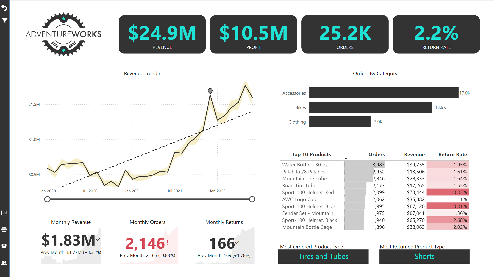
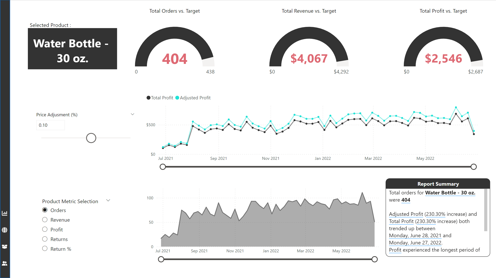
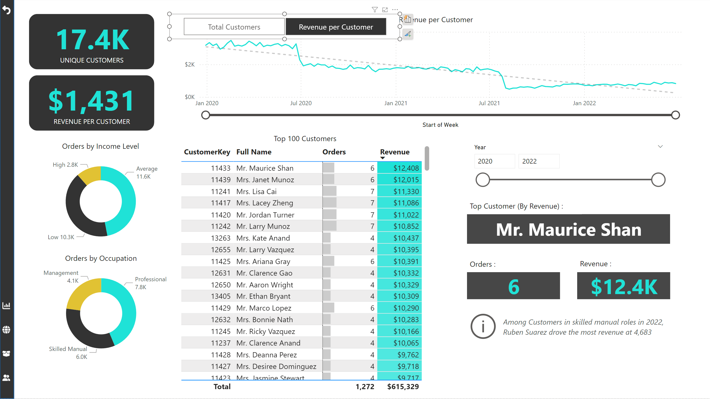
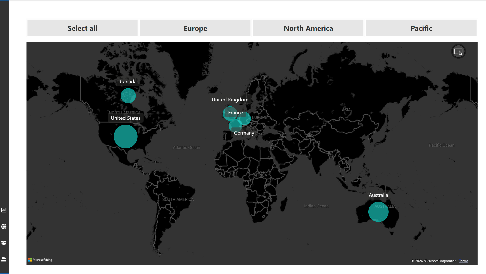
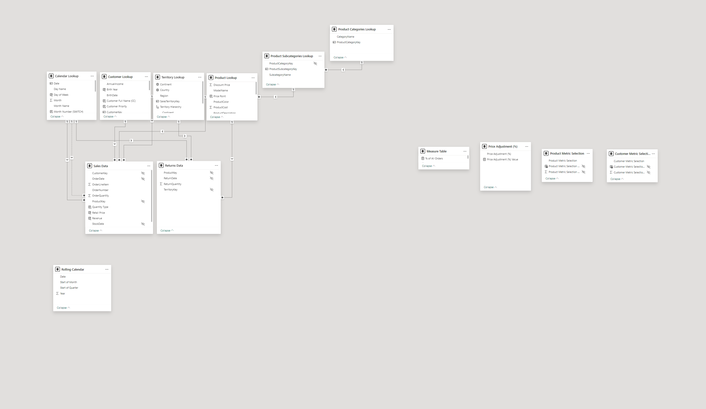

<div align="center">

# AdventureWorks Business Intelligence Dashboard

**An end-to-end Power BI analysis of sales, customers, products, returns, and regional performance using the AdventureWorks sample dataset.**


</div>



## Project Overview

This project turns the fictional AdventureWorks retail dataset into an interactive business intelligence report for monitoring commercial performance and exploring the drivers behind it.

The report brings sales, returns, product, customer, territory, and calendar data into a connected analytical model. Its pages are designed to help decision-makers move from a high-level performance overview to detailed product, customer, and geographic analysis.

## Business Questions

The dashboard is designed to help answer questions such as:

- How are revenue, profit, order volume, and return rate performing over time?
- Which products and categories contribute most to business performance?
- Where are sales geographically concentrated?
- Who are the most valuable customers, and how do customer segments differ?
- Which areas require a closer look because of returns or weaker performance?
- What factors appear to influence selected business outcomes?

## Report Experience

### Executive Overview

A consolidated view of the main business KPIs, trends, category performance, and operational signals.

### Product Analysis

A focused product-level view for comparing individual products, identifying strong performers, and examining sales and return patterns.



### Customer Analysis

A customer-focused page for understanding customer value, purchasing behavior, and demographic patterns.



### Geographic Analysis

An interactive map for exploring how sales are distributed across markets and territories.



### Advanced Exploration

The report also demonstrates several interactive and AI-assisted Power BI visuals:

- [Natural-language Q&A](images/Q%26A.png)
- [Decomposition Tree](images/DecompositionTree.png)
- [Key Influencers](images/KeyInfluencers.png)

These views support guided root-cause exploration and allow users to investigate the data beyond fixed charts.

## Data Model

The model connects transaction tables with calendar, customer, product, category, subcategory, and territory lookup tables.



The structure supports consistent filtering across report pages and makes it possible to analyze performance from multiple business perspectives.

## Skills Demonstrated

- Power BI report and dashboard design
- Data modeling and table relationships
- KPI definition and performance monitoring
- Time-series and category analysis
- Customer and product segmentation
- Geographic data visualization
- Interactive filtering and drill-down
- Business-focused data storytelling
- Q&A, Decomposition Tree, and Key Influencers visuals

## Repository Structure

```text
PowerBI-AdventureWorks-Project/
├── data/       # Calendar, customer, product, territory, sales, and returns data
├── images/     # Dashboard, report-page, and model screenshots
├── reports/    # Power BI Desktop report (.pbix)
├── LICENSE
└── README.md
```

The dataset includes yearly sales extracts for 2020–2022, together with supporting lookup and returns tables.

## Explore the Report

1. Install [Microsoft Power BI Desktop](https://powerbi.microsoft.com/desktop/).
2. Download or clone this repository.
3. Open [`Power BI Project - AdventureWorks Report.pbix`](reports/Power%20BI%20Project%20-%20AdventureWorks%20Report.pbix).
4. If Power BI asks for updated source locations, use **Transform data → Data source settings** and point the sources to the included [`data`](data/) directory.
5. Use the report navigation, filters, and visual interactions to explore the dashboard.

> The screenshots in this repository provide a static preview. Power BI Desktop is required for the full interactive experience.

## Dataset

AdventureWorks is a fictional business dataset commonly used for learning and demonstrating analytics and business intelligence workflows. The repository contains sample data only and does not represent a real company or live business system.

## License

This project is available under the [MIT License](LICENSE).

---

<div align="center">

Built by [Guy Bar](https://github.com/GuyBar7)

</div>
